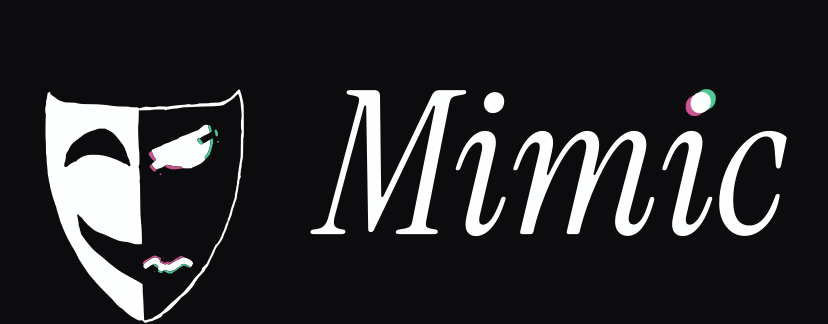

# Mimic brand

Every element has a reason. If you change one, keep the reason or change it on purpose.



## The mask (symbol)

The mask was drawn by hand and is **not redesigned**. The SVGs are a faithful trace of the original
(`assets/mimic_logo_animation.gif`), made layer by layer so the uneven hand-drawn line stays.

| Part | Meaning |
|---|---|
| White half, calm closed eye, smile | The face a honeypot shows: a friendly, ordinary server |
| Dark half, slanted eye, crooked mouth | What is really behind it |
| Pink / mint offsets on the dark half | The glitch: the moment the disguise slips |

| File | Use |
|---|---|
| `mimic-mask-colour.svg` | Default. Works on dark and light backgrounds (the dark silhouette keeps the shape on light) |
| `mimic-mask-small.svg` | 16–48 px (favicons, tabs). No glitch and no specks: at that size they are noise |
| `mimic-mask-black.svg` | One ink on light paper (prints only the dark half) |
| `mimic-mask-white.svg` | One ink on dark (prints only the white half and outline) |

## The wordmark: "Two eyes"

*Instrument Serif Italic*, set as outlines. "Mimic" has two i's, and their dots are the mask's two eyes:

- the **first dot is plain**: the calm white half;
- the **second dot glitches** exactly like the mask's dark-half eye: the same dot, offset pink
  down-left and mint up-right.

It reads as an ordinary word until you look twice. That is what a honeypot does.

| File | Use |
|---|---|
| `mimic-wordmark-dark.svg` / `-light.svg` | On dark / on light backgrounds |
| `mimic-wordmark-*-small.svg` | When the wordmark is narrower than 200 px: the glitch offset grows from 2.5 % to 4 % of the type size, so it stays visible |
| `mimic-wordmark-white.svg` / `-black.svg` | One ink only. The glitch needs colour, so these have a plain dot |

Instrument Serif is under the SIL Open Font License 1.1, which allows use in a logo. It is the
same family as the dashboard headings, so the logo and the product speak with one voice.

## Lockups

| File | Rule |
|---|---|
| `mimic-lockup-horizontal-*.svg` | Mask height = 1.67 × the wordmark's cap height, centred on the cap height. Gap = 0.3 × mask height |
| `mimic-lockup-stacked-*.svg` | Mask above, centred; gap = 0.18 × mask height |

**Clear space:** at least 2 × the height of the i-dot on every side.
**Minimum size:** horizontal lockup 320 px wide. That is where the glitch offset is still about 2 px.
Below it, use the mask alone.

## Colour

One palette for the logo and the dashboard, taken from the colours of the drawing.

| Role | HEX | Meaning everywhere |
|---|---|---|
| Ground | `#0C0B0E` | The dark theatre |
| White | `#FDFEFE` (logo) · `#EDEBE6` (UI text) | |
| Mint | `#51C897` | Got in / allowed |
| Pink | `#CC5392` | Refused / danger / malware |

The drawing's pink was `#C9478B`. It was lifted by 3 % lightness, keeping the same hue, to `#CC5392`, so
pink text passes WCAG AA on the ground (4.5:1). Mint is 9.4:1.

Mint and pink are **never decoration**: in the product they always mean "got in" and "refused".
On the mask they are the glitch, and the wordmark's dot borrows exactly that.

## Don't

- Redraw, smooth or "clean up" the mask. Its unevenness is the point.
- Put the glitch on the first i-dot, or on both. One calm eye, one glitched eye.
- Use mint or pink for anything that does not mean allowed or refused.
- Add shadows, gradients or outlines to the mask or the wordmark.

## Regenerate

```bash
pip install potracer fonttools brotli
python tools/brand/trace_mask.py assets/mimic_logo_animation.gif assets/brand/mimic-mask-colour.svg colour
#   …and the same with: small, black, white
python tools/brand/build_kit.py
```
